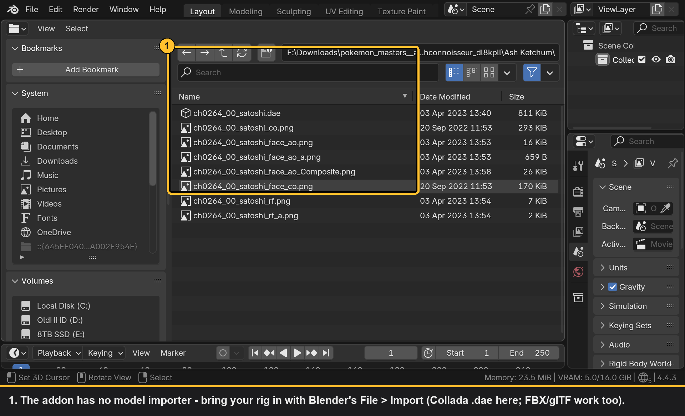
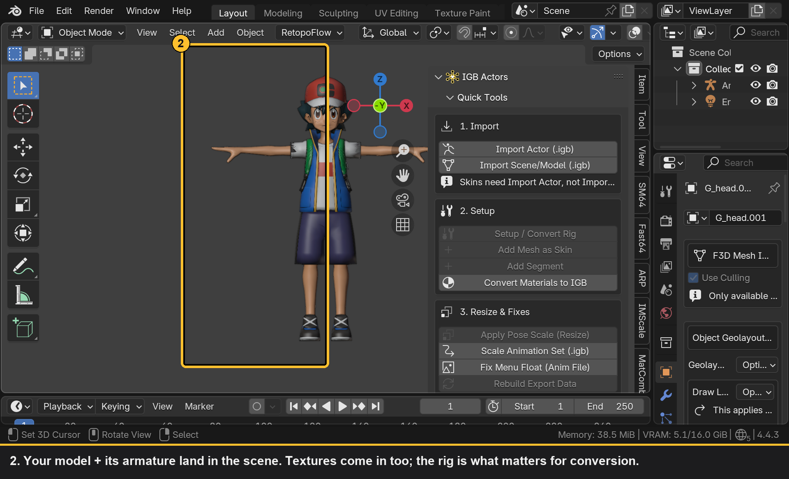
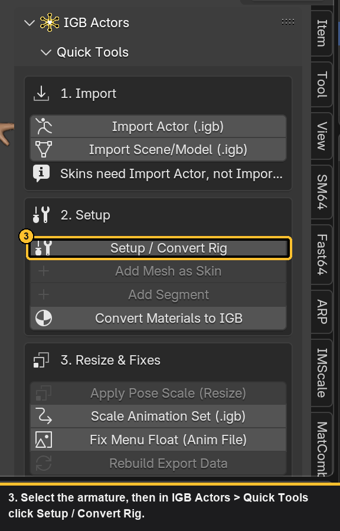
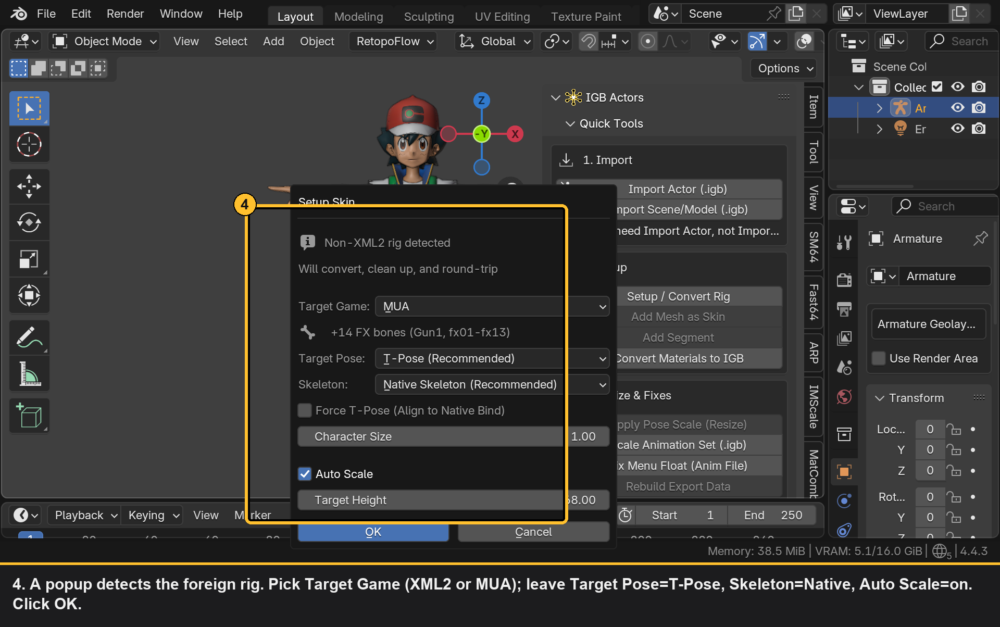
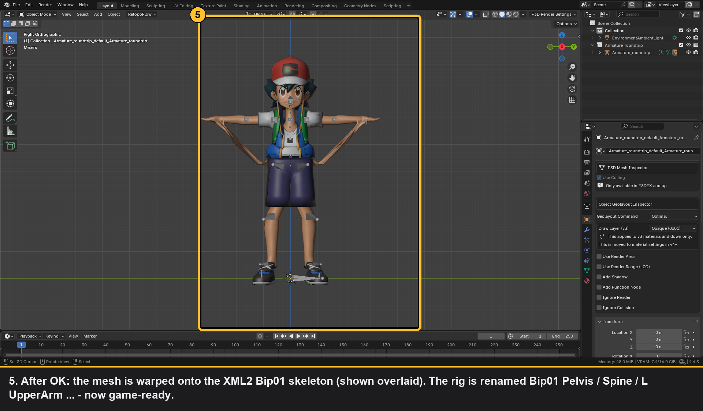
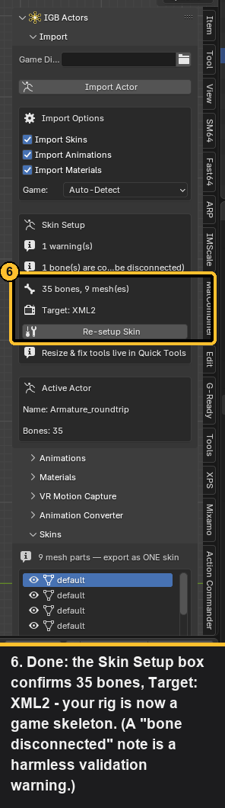
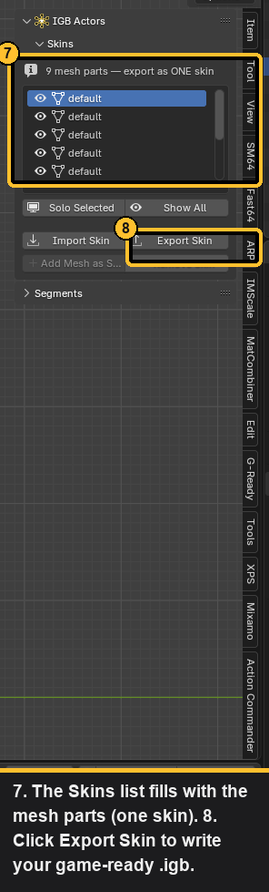

# Tutorial: Convert a Custom Model to XML2 / MUA

> **DRAFT — verify before publishing.** Screenshots were auto-captured from a
> live Blender session using **Ash Ketchum** (Pokémon Masters, a COLLADA
> `.dae`) as the example. Each image has its own numbered callouts + caption.
> Regenerate with `tools/shoot_convert_tutorial.py` then
> `tools/annotate_convert.py` (raw captures kept in
> `docs/images/convert/_raw/`).

This walkthrough takes a custom rigged character (VRChat, Mixamo, a ripped
game model, anything with an armature) and converts it into a game-ready
X-Men Legends II / Marvel Ultimate Alliance skin.

**You need:**
- Blender 4.4 with the IGB addon installed and enabled
  (see [README — Installation](../README.md#installation))
- A rigged humanoid model in a format Blender can import (`.fbx`, `.dae`,
  `.glb`/`.gltf`)

**The big picture:** Blender imports your model → the addon's **Setup /
Convert Rig** renames the skeleton to the game's `Bip01` biped, warps the
mesh onto it, and prepares everything → you **Export Skin** to `.igb`.

---

## Step 0 — Import your model (Blender's own importer)

The IGB addon does **not** import FBX/DAE/glTF — use Blender's built-in
**File ▸ Import**. (If your model needs cleanup first, run it through
[CATS](https://github.com/absolute-quantum/cats-blender-plugin) before this.)

> If a model imports untextured, that's a material/texture path issue in the
> source file — it does **not** affect the rig conversion. Fix materials
> afterward in the **Materials** panel.

---

## Step 1 — Select the armature and Convert

Select the imported **armature**, open the **IGB Actors** tab (press `N`),
and in **Quick Tools** click **Setup / Convert Rig**. (The same button also
appears in the Import panel's "Skin Setup" box.)

---

## Step 2 — Choose the conversion options

A popup opens (it does **not** run on click — you confirm with **OK**). For a
first conversion the defaults are correct; the only choice you usually make is
**Target Game**.

What the options do:

| Option | Recommendation |
|--------|----------------|
| **Target Game** | **XML2** (35 bones) or **MUA** (adds 14 FX bones: Gun1, fx01–fx13). Pick your game. |
| **Target Pose** | **T-Pose** — required so the game's stock animations (idle/walk/attack) play correctly. |
| **Skeleton** | **Native Skeleton** — warps the mesh onto the game's exact shared biped so it behaves like every official character (no floating/sinking). |
| **Auto Scale** | **On** — anchors the pelvis at the native height (~41.82) so feet stay on the ground. |
| **Force T-Pose** | **Off** unless fingers/thumbs look wrong — it deforms the mesh to hit exact bind directions. |
| **Character Size** | Leave **1.0**. To make a character bigger/smaller in-game, use the herostat `scale_factor` instead. |

---

## Step 3 — Conversion runs automatically

Clicking OK renames the skeleton to the `Bip01` biped, warps the mesh, and
does a full export/re-import round-trip for you. No manual re-import needed.

---

## Step 4 — Export the skin

Click **Export Skin (.igb)** (in Quick Tools, or the Skins panel). Pick a
path, keep **Skin Format = XML2 Native v6 (Stable)**, and export.

> Drop the `.igb` into your game's `actors/` folder (named to a character
> slot, e.g. `0401.igb`) to use it in-game.

---

## Tips & gotchas

- **Multiple meshes are normal.** A model with many mesh objects becomes many
  rows in the Skins list — they all export into **one** skin file. Use
  **Add Mesh as Skin** / **Add Segment** (Quick Tools step 2) to attach extra
  parts (weapons, capes) before exporting.
- **Re-running is safe.** After conversion the button becomes **Re-setup
  Skin**; resize/fix tools move to **Quick Tools ▸ 3. Resize & Fixes**.
- **Untextured after import?** The rig still converted fine — reassign
  textures in the **Materials** panel, then export.
- **Two entry points.** Both **Setup / Convert Rig** and **Export Skin** live
  in the **Quick Tools** panel and in the older Import/Skins panels — use
  whichever you prefer.

---

## See also

- [Importing a game skin](TUTORIAL_SKIN_IMPORT.md) — the reverse direction
- [README](../README.md) — full panel reference
