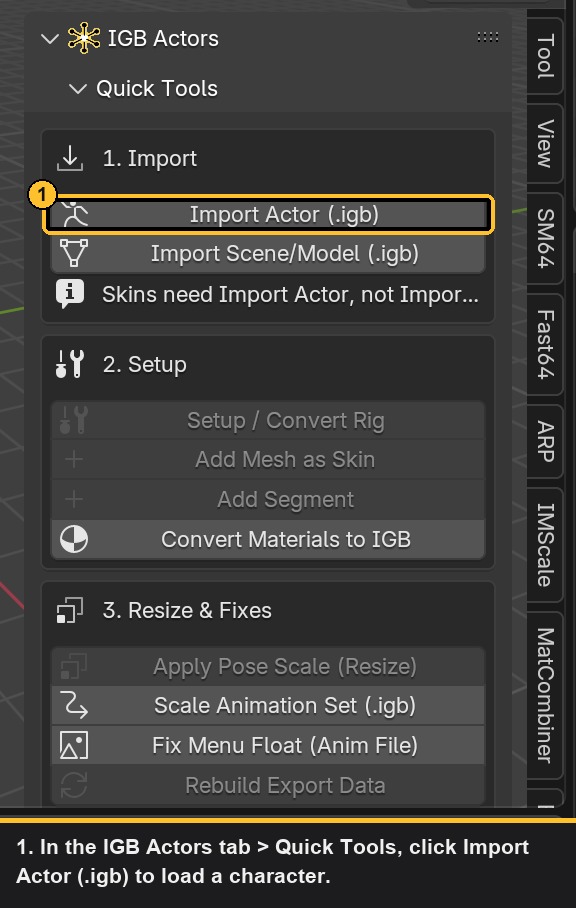
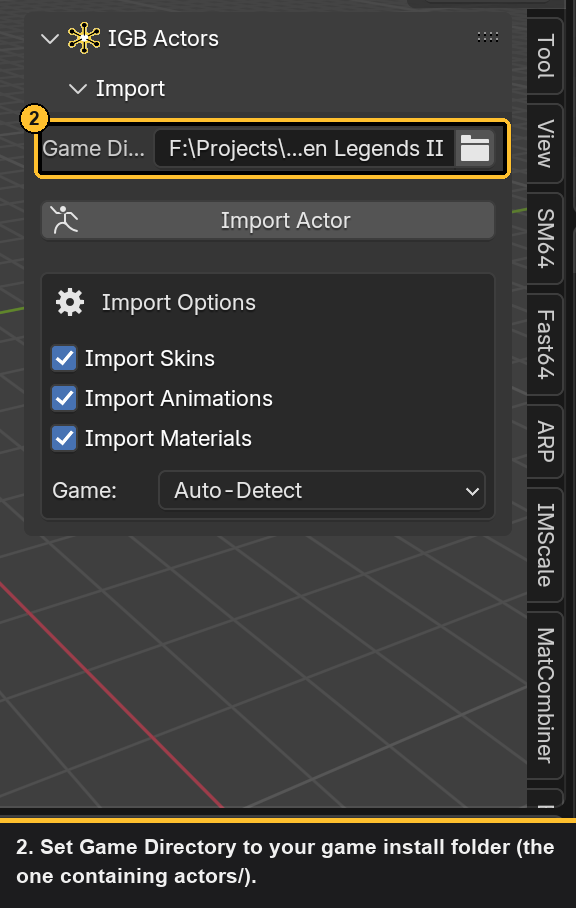
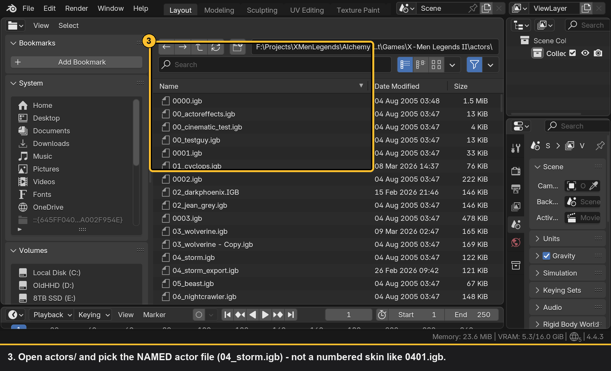
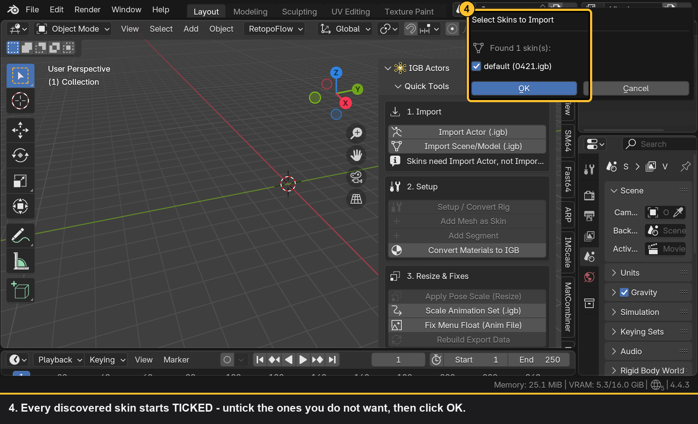
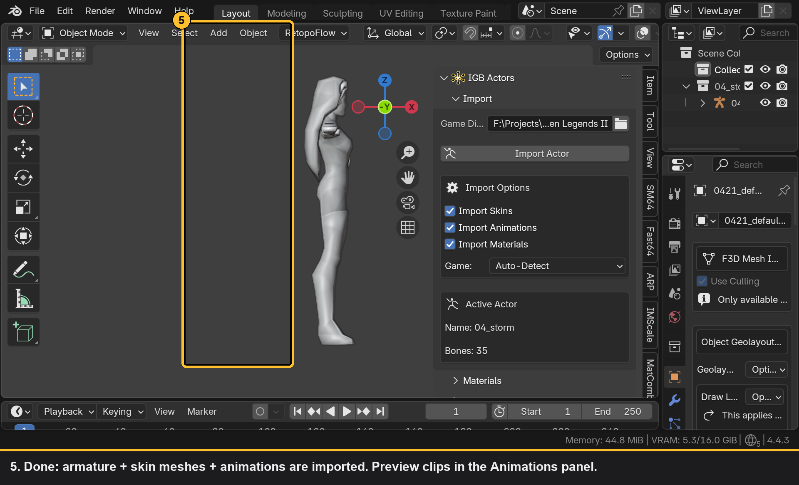
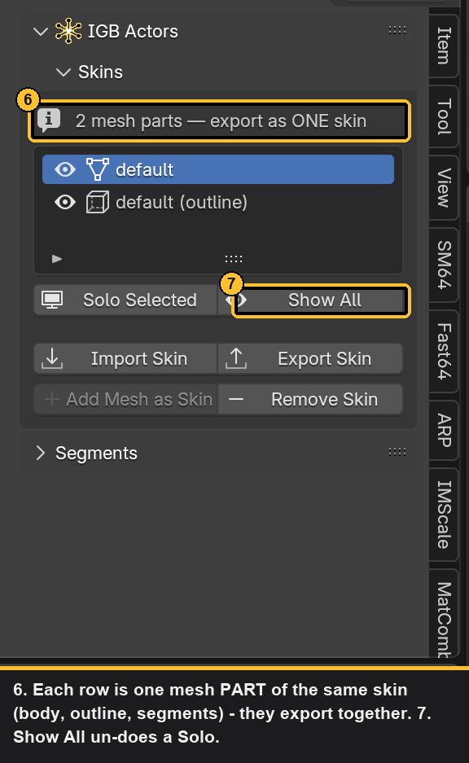

# Tutorial: Importing a Character Skin into Blender

> **DRAFT — verify before publishing.** Screenshots in
> `docs/images/skin_import/` were auto-captured from a live Blender session
> (Storm / `04_storm.igb`) and annotated with numbered highlight boxes +
> caption footers. Skim them for accuracy. To regenerate: recapture with
> `tools/shoot_tutorial.py`, then re-annotate with `tools/annotate_tutorial.py`
> (pristine captures are kept in `docs/images/skin_import/_raw/`).

This walkthrough takes you from a fresh Blender scene to a fully rigged,
textured X-Men Legends II / Marvel Ultimate Alliance character with its
animations — ready to edit and export back to the game.

**You need:**
- Blender 4.4 with the IGB addon installed and enabled
  (see [README — Installation](../README.md#installation))
- A PC install of X-Men Legends II or Marvel Ultimate Alliance

**Time:** about 2 minutes once you know the clicks.

---

## The one thing to know first

Character files come in **pairs** inside the game's `actors/` folder:

| File | What it is | Example |
|------|------------|---------|
| `NN_name.igb` | The **actor** — skeleton + animations | `03_wolverine.igb` |
| `NNYY.igb` (4-digit number) | A **skin** — mesh + textures for outfit YY | `0301.igb`, `0302.igb`... |

You always import the **actor** file (the one with the character's name in
it) — the addon finds and offers the matching numbered skins automatically.
(Importing a skin file through the generic **IGB** tab gives you a statue:
geometry with no bones, no weights, no animations.)

---

## Step 1 — Open the IGB Actors tab

In the 3D Viewport press **N** to open the sidebar, then click the
**IGB Actors** tab.

---

## Step 2 — Set your Game Directory (recommended)

In the **Import** panel, point **Game Directory** at your game install
folder (the one containing `actors/`, e.g.
`C:\Program Files (x86)\Activision\X-Men Legends 2`).

This makes the file browser open straight in `actors/` and lets the addon
use the game's herostat to match skins precisely. (Skin discovery still
works without it as long as you pick files from the game's own `actors/`
folder — the addon scans for matching skin numbers next to the actor file.)

---

## Step 3 — Import Actor

Click **Import Actor** (in Quick Tools the same button is labeled
**Import Actor (.igb)**; it's also under
**File ▸ Import ▸ Alchemy Actor (.igb)**).

In the file browser, pick the character's **named** actor file from
`actors/` — for Wolverine that's `03_wolverine.igb`, **not** `0301.igb`.

> The actor files are easy to spot: they have the character's name right
> in the filename (`01_cyclops.igb`, `04_storm.igb`...). The number prefix
> is the character's slot, and their skins are the 4-digit files starting
> with the same two digits.

---

## Step 4 — Pick the skins you want

If the addon found matching skin files, a **Select Skins to Import** popup
appears. **All discovered skins start ticked** — untick the outfits you
don't want and confirm. (The one named *default* is the standard costume,
file `NN01.igb`.)

---

## Step 5 — Done. Here's what you got

- **An armature** (the Bip01 skeleton) — now the *active actor*
- **Skin meshes** parented to it, fully weighted, textures applied
- **Animations** listed in the **Animations** panel — select one and hit
  **Play** to preview; **Rest Pose** to reset

### About the Skins list

Open the **Skins** panel and you'll see **several rows for one character**.
That's normal: each row is one **mesh part** of the same skin — the body,
the black outline shell, and any toggleable segments (Bishop's guns, capes,
etc.). They all export together as one skin file. The icons tell them apart:

| Icon | Meaning |
|------|---------|
| mesh | body part |
| wireframe | outline shell |
| object | named segment |

Use the eye toggles to hide parts while working, **Solo Selected** /
**Show All** for quick isolation, and the **Segments** sub-panel for
per-part details and visibility flags that carry into the game.

---

## Common problems

| Symptom | Cause / fix |
|---------|-------------|
| Mesh imported but no skeleton or animation | You used **IGB ▸ Import IGB (.igb)** or picked the skin file. Undo, use **Import Actor** on the named actor file. |
| "No skeleton found" error | You picked a non-actor file (map, prop, HUD element). |
| Character is grey / no textures | Enable **Import Materials** in the Import panel options before importing. |
| Select Skins to Import popup never appears | Check **Import Skins** is on in the Import panel options. If your files use non-standard names, set **Game Directory** so the addon can match skins via herostat. |
| Animations panel is empty | Check **Import Animations** was enabled; some actors store animations in a separate shared file (e.g. `common.igb`) — use the Animations panel's **Import Animations** button on that file. |

---

## Where to next

- **Export your edits:** Quick Tools ▸ **Export Skin (.igb)** — see the
  README's export options (CLUT textures are the safe universal choice).
- **Port a custom character (VRChat / Mixamo / etc.):** import your model,
  select the armature, **Setup / Convert Rig** in Quick Tools. (Separate
  tutorial planned.)
- **Toggleable parts:** see the Segments section in the
  [README](../README.md#segments).
